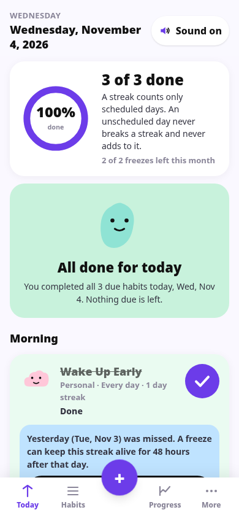

# Habit Tracker — Streaks that stay honest

Habit Tracker is a habit tracker prototype that keeps its streaks honest: a streak only counts days the habit was actually scheduled.

## What it does

- Check, count, and duration habits, with a focus timer.
- Daily, weekday, weekend, custom, and flexible weekly schedules, and two streak freezes a month for real life.
- Progress rings, a heatmap with past corrections marked as edited, templates and categories, and milestone badges.
- CSV and JSON export and import.
- It starts with two example habits at zero: no fake history, no fake badges.

## Status

Working prototype, built November 2026.

## Showcase only

This repository is a showcase. It contains no source code and no build files, and nothing here is open source. The screenshot(s) above are showcase images only. See NOTICE.md.

## Contact

Built by Yash Dashrath, Pune, India.

- Email: yashdashrath18@gmail.com
- LinkedIn: https://www.linkedin.com/in/yash-dashrath
- Yash MediaWorks: https://www.linkedin.com/company/yashmediaworks/
